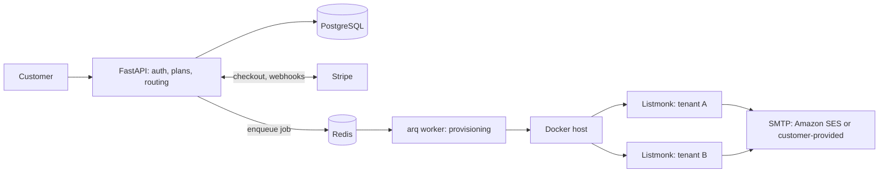
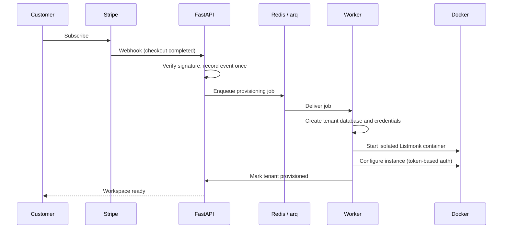
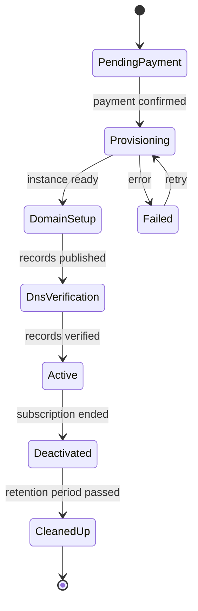

# QeakFlow Architecture

Design notes for **QeakFlow**, a managed, privacy-first email marketing platform for the DACH market, built as a multi-tenant service on top of [Listmonk](https://listmonk.app).

This repository contains **documentation only**: diagrams, design decisions and lessons learned. The application code is proprietary and not published here.

> Built and operated by a single engineer: backend, infrastructure, billing and provisioning.

---

## 1. Problem and constraints

Small businesses in Germany want newsletters without Mailchimp's pricing jumps and without sending subscriber data to third parties (GDPR).

Design constraints that shaped the architecture:

- **Strong tenant isolation:** one customer's data and failures must not affect another's.
- **Fully automated onboarding:** payment to a working workspace with no manual steps.
- **Solo operation:** every component must be simple to run, observable and recoverable by one person.
- **EU-hosted, minimal tracking by default.**

## 2. System overview

| Layer | Technology |
|---|---|
| API, auth, billing logic | FastAPI (Python) |
| Data | PostgreSQL |
| Background jobs | arq + Redis |
| Tenant runtime | Docker / Docker Compose, one Listmonk instance per tenant |
| Payments | Stripe (webhook-driven) |
| Sending | Amazon SES or customer-provided SMTP |

## 3. Tenant provisioning flow

Payment triggers provisioning automatically; the customer never waits on a human.

## 4. Onboarding state machine

## 5. **Sender-domain authentication**

- A DKIM keypair is generated per tenant during onboarding; the customer receives the DNS records to publish.
- A DNS verification service (Python, `dnspython`) checks the published records before sending is enabled.

**SPF.** A domain may publish only one SPF record, and most customers already have one. QeakFlow therefore shows the `include:` mechanism for the tenant's SMTP provider to merge into the existing record, never a second record. Verification parses the record instead of comparing strings. It checks that the provider's include is present and the record ends in `~all` or `-all`. It also flags multiple SPF records and records over the 10-DNS-lookup limit, both of which cause a permanent SPF error.

**DKIM.** Verification resolves `<selector>._domainkey.<domain>`, joins multi-string TXT values, normalizes whitespace, and compares the `p=` key with the stored public key.

**DMARC.** DMARC is advisory and does not block sending. Verification only checks that a valid `v=DMARC1` record with a `p=` tag exists, and accepts any existing policy. For new setups we suggest `p=none` with an `rua` address, then tightening to `quarantine` once reports look clean.

**Gating.** Sending is enabled when SPF and DKIM pass. A missing DMARC record shows a warning.

**Re-check strategy.**
- A manual "Verify" button, rate-limited per domain.
- After a failed check, automatic background re-checks with backoff: 1 min, 5 min, 15 min, 1 h, then every 6 h for up to 72 h to cover DNS propagation. After that the status becomes `expired` and the user can restart.
- Queries go to public resolvers rather than the host's resolver.
- Timeouts and SERVFAIL are treated as `unknown` and retried. Only a definitive "no record" counts as `missing`, and a single timeout never flips a verified domain to failed.
- Verified domains are re-checked daily. If records disappear, the domain becomes `degraded`, the customer is notified, and sending is paused only after a grace period (e.g. 72 h).

**Failure display.**
- Each record (SPF, DKIM, DMARC) shows its own status: `valid`, `missing`, `mismatch`, `conflict` or `unknown`.
- Each record shows the exact host and value with a copy button, the last-checked time, and the next automatic check.
- Each failure comes with a specific hint, never a generic "verification failed":
  - "Many registrars append the domain automatically, so enter `qeakflow._domainkey`, not the full name."
  - "Remove surrounding quotes."
  - "You have two SPF records, merge them into one."
- The last result is persisted, so the page loads without a live DNS lookup.
## 6. Key design decisions

### 6.1 One Listmonk instance per tenant
- **Why:** hard isolation of data and failures, simple per-tenant deletion for GDPR, no changes needed to Listmonk's single-tenant design.
- **Trade-off:** higher resource cost per tenant and more orchestration work.
- **Mitigation:** automated provisioning and cleanup, so operational cost stays low for one person.

### 6.2 Provisioning as background jobs
- **Why:** provisioning is slow and can fail halfway; it must not block webhooks or HTTP requests.
- **How:** arq workers with Redis, jobs designed to be safely retried.
- **Idempotent provisioning & crash recovery** (State reconciliation, dangling container cleanup, and an automated rollback stack to safely handle workers dying mid-way)

### 6.3 Webhook-driven billing
- **Why:** Stripe is the source of truth for subscription state; the API reacts to events instead of polling.
- **How:** verifies each Stripe webhook signature, stores the Stripe event ID with a unique constraint to prevent duplicate processing, and processes events idempotently. For out-of-order events, it retrieves the latest subscription state from Stripe before updating the local subscription record and synchronizing the tenant's Listmonk instance.

### 6.4 Bring-your-own SMTP
- **Why:** lets customers use their own sending reputation and keeps deliverability responsibility transparent.
- `[TODO: why SES as default, rate-limit handling]`

## 7. Failure modes and how they were handled

| Problem | Cause | Resolution |
|---|---|---|
| Provisioned instance rejected API calls after upgrading Listmonk to v6 | Authentication changed to token-based | Moved the provisioning flow to token-based auth and verified it end to end |
| `[TODO]` | `[TODO]` | `[TODO]` |
| `[TODO]` | `[TODO]` | `[TODO]` |

## 8. Lifecycle and cleanup

- Scheduled job deactivates tenants whose subscription ended and removes their resources after a retention period.
- `[TODO: what gets deleted, what is kept for billing, how deletion is verified]`

## 9. What I would do differently

`[TODO: 2-3 honest lessons, e.g. things you'd design earlier, simplify or measure from day one]`

## 10. Roadmap

Custom domains per tenant, white-label option for agencies, usage dashboard, template builder, Zapier/webhook integrations.

---

**Author:** Andrii Mahalias · [qeakflow.com](https://www.qeakflow.com)
